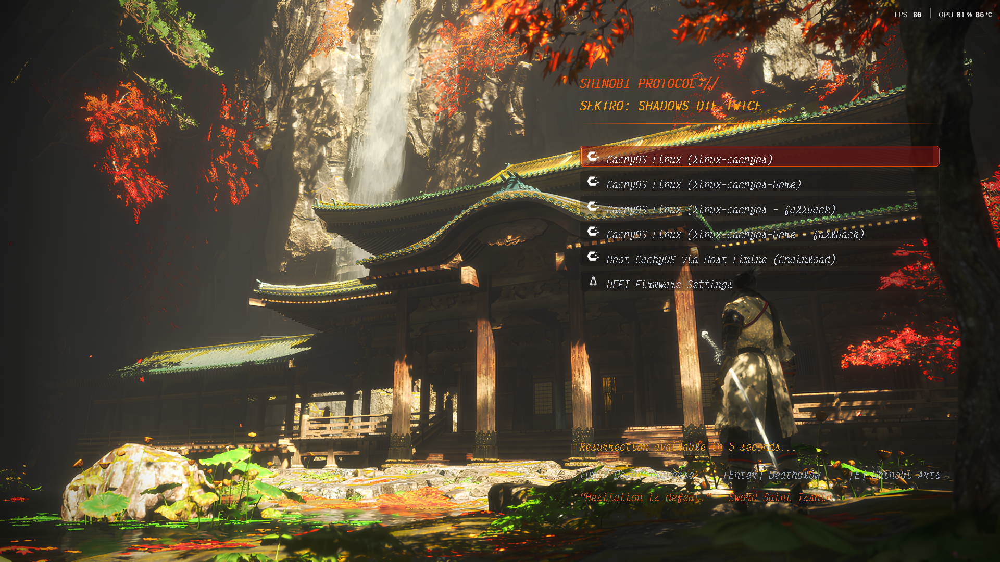
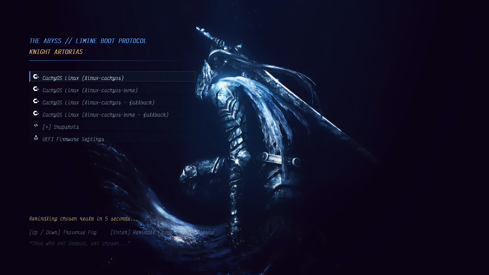
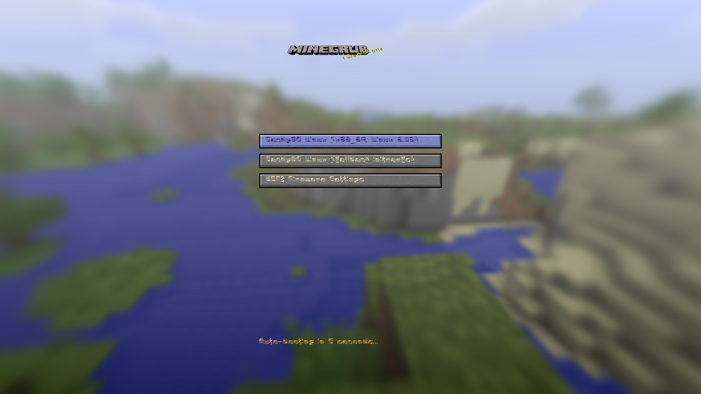
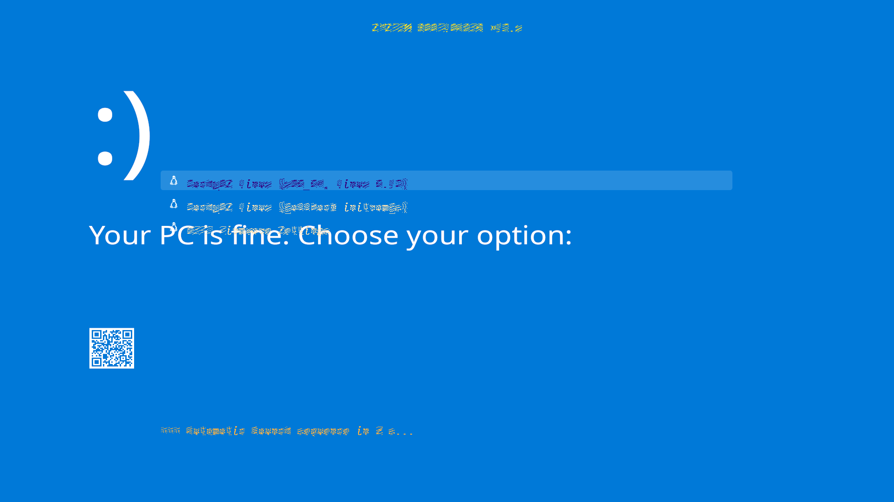

# Limine: Riceable Edition 🍚🎨
[](LICENSE)
[]()
[]()

> **The modern, blazing-fast, multiprotocol bootloader — now with full GRUB-compatible graphical theming and live offline previews.**

### All new features vibecoded and alpha-stage. NOT to be used on real hardware yet.
---

## 🌟 Overview

[Limine](https://limine-bootloader.org/) is loved for its speed, cleanliness, and rock-solid reliability. However, community ricing enthusiasts have long missed the rich graphical themes of GRUB and rEFInd.

**Limine: Riceable Edition** bridges this gap: it introduces a native, high-performance graphical theme engine directly into Limine's boot stage while maintaining the bootloader's legendary speed and minimal memory footprint.

Even better: it implements **GRUB theme format compatibility**, meaning you can run existing GRUB themes (such as those from Gnome-Look, Pling, or r/unixporn) with zero hassle.

---

## 📸 Screenshots

### 🗡️ Sekiro: Shadows Die Twice Theme
*Right-aligned Shinobi layout, 3-slice vermillion lacquer selection box, custom PFF2 typography, Katana slash divider, and resurrection countdown.*


### ⚔️ Dark Souls: Artorias of the Abyss
*Atmospheric Dark Souls aesthetic, Abyss glow selection highlight, and custom serif fonts.*


### ⛏️ Minecraft & Terminal Dark
| Minecraft Theme | Retro Terminal Dark |
|:---:|:---:|
|  |  |

---

## ✨ Features

- **🎨 Full GRUB-Compatible Theme Specification:**
  - Parses standard GRUB `theme.txt` files (`+ boot_menu`, `+ label`, `+ image`, `+ progress_bar`).
  - Supports 9-slice and 3-slice pixmap boxes (`pixmap_style` with corner/edge slicing for buttons and selection rectangles).
  - Relative coordinate evaluation: handles percentage arithmetic (e.g. `50%-200`, `100%-80`, `25%+50`).
  - `#RRGGBB` hex color and named color parsing.
- **🔤 Native PFF2 Bitmap Font Rasterizer:**
  - Fast, zero-copy GRUB `.pf2` (PFF2) font loader.
  - Continuous packed bitstream rasterizer with sub-pixel alignment.
  - Full UTF-8 multi-byte Unicode codepoint decoder.
- **🎞️ Animated GIF Backgrounds:**
  - Multi-frame animated background support directly in UEFI and BIOS boot stages.
  - Frame delay synchronization with boot countdown timers.
- **⚡ High-Performance Software Canvas:**
  - Fast 32bpp and 24bpp display flush paths.
  - Alpha transparency blending (true transparency and semi-transparent alpha overlays).
  - Dirty-region updates to avoid redrawing static elements every tick.
- **🖥️ 1:1 Live Offline Previewer (`tools/preview_theme.py`):**
  - Design, test, and render your themes at 4K, 1080p, or 720p instantly on your desktop without rebooting or spinning up a virtual machine!
- **📦 Drop-in Ready:**
  - Fully backward compatible with standard Limine configurations. If no `theme:` directive is specified, it gracefully defaults to the standard terminal menu.

---

## 🚀 Quick Start

### 1. Requirements

On Arch Linux / CachyOS / Manjaro:
```bash
sudo pacman -S base-devel clang lld nasm python python-pillow
```

On Debian / Ubuntu:
```bash
sudo apt update && sudo apt install -y build-essential clang lld nasm python3 python3-pil
```

### 2. Building

Clone and build the UEFI x86-64 binary:
```bash
git clone git@github.com:SKAND9337/limine-but-riceable.git
cd limine-but-riceable
./bootstrap
./configure --enable-uefi-x86-64 --enable-bios
make -j$(nproc)
```

The resulting EFI binary will be at `bin/BOOTX64.EFI`.

---

## 🎨 Using Themes

Add the `theme` directive to your `limine.conf`:

```ini
timeout: 10
interface_resolution: 1920x1080

# Load your custom theme
theme: boot():/themes/sekiro/theme.txt

/CachyOS Linux
    protocol: linux
    path: boot():/vmlinuz-linux-cachyos
    module_path: boot():/initramfs-linux-cachyos.img
    cmdline: quiet splash rw

/UEFI Firmware Settings
    protocol: efi_chainload
```

Place the theme directory (containing `theme.txt`, images, and fonts) onto your boot drive at `/themes/<theme-name>/`.

---

## 🖥️ Live Theme Preview Tool

Test any theme right in your terminal before copying it to your EFI partition:

```bash
# Render a 1080p preview image
python3 tools/preview_theme.py themes/sekiro/theme.txt preview.png 1920 1080

# View it in your image viewer (e.g. imv, feh, kitty)
imv preview.png
```

---

## 🧪 Testing & Validation

The codebase includes comprehensive unit tests and automated theme validation:

```bash
# Run C unit tests (coordinate math, color parsing, PFF2 bitstream, clipping)
gcc -O2 -o test_runner tests/test_theme_unit.c && ./test_runner

# Run multi-resolution theme validation suite
python3 tools/test_themes.py
```

---

## 📁 Repository Structure

```
limine-but-riceable/
├── common/
│   ├── theme/          # The Limine Theme Engine (parser, draw, box, pff2 font)
│   ├── menu.c          # Boot menu hooks and input handling
│   └── lib/image.c     # Hardened image decoder (PNG, JPEG, BMP, GIF)
├── themes/             # Curated example themes
│   ├── sekiro/         # Sekiro: Shadows Die Twice
│   ├── artorias/       # Dark Souls: Artorias of the Abyss
│   ├── minecraft/      # Minecraft Boot Screen
│   ├── terminal-dark/  # Retro Minimalist Terminal
│   └── astronaut/      # Sci-Fi Astronaut
├── tools/              # Preview and validation utilities
│   ├── preview_theme.py # Exact 1:1 offline desktop theme renderer
│   └── test_themes.py  # Automated regression & resolution tests
├── tests/              # C unit test suite
└── docs/               # Screenshots and theme format specification
```

---

## 📜 Credits & License

- Based on the outstanding [Limine Bootloader](https://github.com/Limine-Bootloader/Limine) by **Mintsuki**, **Kamila Szewczyk**, and contributors.
- Licensed under the **2-Clause BSD License** (see [LICENSE](LICENSE)).
